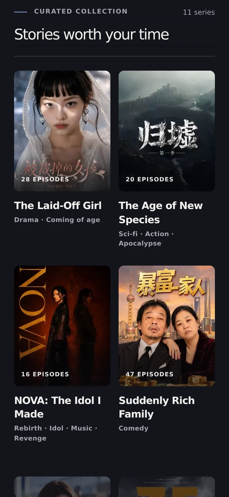

<h1 align="center">Reelbound</h1>

<p align="center">
  <strong>Stories selected to stay with you.</strong><br>
  A curated, cinematic home for AI-generated short-form series.
</p>

<p align="center">
  <a href="README.md">English</a> · <a href="README.zh-CN.md">简体中文</a>
</p>

<p align="center">
  <a href="https://github.com/yeoyujie/reelbound/actions/workflows/ci.yml"></a>
  <a href="LICENSE"></a>
  <a href="https://nextjs.org/"></a>
  <a href="https://react.dev/"></a>
  <a href="https://www.typescriptlang.org/"></a>
  <a href="https://pnpm.io/"></a>
</p>

<p align="center">
  
</p>

Reelbound brings a series-first, Netflix-style model to short-form video.
Instead of an endless feed, you **discover a series, open it at episode one, and
keep watching in order** through the official Douyin player.

```text
Discover a series  →  Open an episode  →  Watch  →  Continue to the next episode
```

> This is a personal, non-commercial project. It currently has no accounts,
> payments, advertising, or user tracking.

## A look inside

### Discover

A hand-picked catalogue of series rather than unrelated videos. Cards stay
lean, with poster, episode count, title and genres. Hover or keyboard focus
expands a card over the shelf to reveal its synopsis and a play action while
the rest of the shelf dims. Every card opens its series at the first episode.

<p align="center">
  
</p>

### Watch

The player leads, with the full episode list beside it and the current episode
clearly marked. Large **previous / next** buttons name the episode they lead to,
so it is always obvious where you go next.

<p align="center">
  
</p>

### Made for your phone

Mobile is designed rather than shrunk: the catalogue becomes a two-column
poster grid, and on the watch page the player comes first, then the episode
details, a full-width **Next episode** button, and a numbered episode grid.

<table>
  <tr>
    <td align="center" width="33%"></td>
    <td align="center" width="33%"></td>
    <td align="center" width="33%"></td>
  </tr>
  <tr>
    <td align="center"><sub>Featured series</sub></td>
    <td align="center"><sub>Two-column poster grid</sub></td>
    <td align="center"><sub>Player first, then what comes next</sub></td>
  </tr>
</table>

### English and 简体中文

Every page is available in English and Simplified Chinese, with titles,
descriptions and episode labels localized for each audience, not just
translated UI chrome.

<table>
  <tr>
    <th width="50%">English</th>
    <th width="50%">简体中文</th>
  </tr>
  <tr>
    <td></td>
    <td></td>
  </tr>
  <tr>
    <td align="center"></td>
    <td align="center"></td>
  </tr>
</table>

<details>
<summary>More Chinese screenshots</summary>
<br>

| Homepage | Catalogue | Mobile |
| --- | --- | --- |
|  |  |  |

</details>

<sub>All screenshots are taken in dark mode, which is the default; a light theme is one click away.</sub>

## What it includes

- A curated catalogue of **series**, with designed fallback artwork when a
  series has no configured thumbnail
- Catalogue cards that expand on hover or keyboard focus to show details,
  with reduced-motion support
- Seasons, specials, split episodes and compilations, numbered automatically
- Shareable, episode-specific URLs such as `/en/series/gui-xu/episode/2`
- Link preview cards for every episode and the homepage, showing the series
  poster, title and episode in the page's language. They appear in Telegram,
  WhatsApp, Discord, Slack, iMessage, X, Facebook and LinkedIn. WeChat, Douyin
  and Xiaohongshu don't read standard link-preview tags, so links shared there
  show no card
- Official Douyin iframe playback, sized responsively for portrait video
- Previous / next episode buttons that name their destination
- An episode list that keeps the current episode visible and clear
- English and Simplified Chinese, plus dark and light themes
- Static TypeScript content with no database, backend API, or account system
- Automated linting, production builds, dependency auditing, and secret
  scanning in GitHub Actions

## Tech stack

- [Next.js](https://nextjs.org/) 16 App Router
- [React](https://react.dev/) 19
- TypeScript
- Tailwind CSS 4, alongside the project’s existing global CSS
- pnpm
- Vercel for deployment
- [Douyin’s official embedded player](https://open.douyin.com/) for video
  playback, with metadata and player dimensions retrieved through the
  [Douyin Open Platform API](https://developer.open-douyin.com/docs/resource/zh-CN/developer/introduction/overview)

There is deliberately no database or CMS. This keeps the project easy to
understand and makes the curated catalogue reproducible from source control.

## Current scope

Reelbound is currently a curated viewing platform, not a social network. There
are no user accounts, social sign-in, profiles, comments, likes, follows,
personalized recommendations, or save-for-later lists. The catalogue is
intentionally selected and maintained as static TypeScript content.

## Roadmap

Possible future work, in priority order:

- Add a backend and database when persistent user features are ready
- Support optional social sign-in and user accounts
- Let viewers save episodes or series for later
- Add viewing progress and continue-watching history
- Introduce comments and other carefully moderated community features
- Improve catalogue management with a lightweight editorial workflow
- Add richer metadata, search, and discovery tools as the catalogue grows
- Explore WeChat link previews, which need WeChat's own sharing SDK and a
  domain registered in mainland China

These are exploratory ideas, not implemented features or guarantees. Any
account or community functionality would need clear privacy, moderation,
security, and data-retention policies before launch.

## Run locally

Use Node.js 24 and pnpm 12.10.1. The pnpm version is pinned in
[`package.json`](package.json).

```bash
pnpm install --frozen-lockfile
pnpm dev
```

Open [http://localhost:3000](http://localhost:3000).

For a production-like local run:

```bash
pnpm build
pnpm start
```

## Catalogue content

The canonical content model is in
[`data/series/types.ts`](data/series/types.ts). Each series has its own file in
[`data/series/`](data/series/), and [`data/series.ts`](data/series.ts) is the
ordered catalogue manifest.

### Add or update a series

To add a series, create a typed file in `data/series/` and add its import and
entry to `data/series.ts`. Move entries in `data/series.ts` to change the
homepage order; the first entry is displayed first. Keep episode arrays ordered
by episode number because they also control previous/next navigation.

### Localize titles and descriptions

Because Reelbound presents Chinese Douyin series for an English-speaking
audience, the original Chinese title is the canonical source title. Treat
`title.en` as an editorial localization that can be refined independently, and
use a stable Hanyu Pinyin identifier for new slugs and content filenames when
the source title is Chinese (for example, `归墟` → `gui-xu`). Branded names such
as `NOVA` can keep their original Latin spelling.

### Content fields

Each series contains:

- `slug`: stable URL segment
- `title` and `description`, each with `en` and `zh` text
- optional `tags`, `thumbnail` and season titles
- an ordered `episodes` array

Each episode needs only a public Douyin `videoId`. Episode numbers and URL
segments are derived from list order within each season, so `title`, `label`,
`season`, `kind` (`special` or `compilation`) and the other fields are optional.
Optional `videoWidth` and `videoHeight` values can be provided when known;
otherwise the app uses the player’s portrait defaults and may look up
dimensions from Douyin’s iframe API. `previewUrl` is reserved for a future
feature and is not currently used.

### Episode routes and document titles

Episode pages are generated from the catalogue at build time. The route is:

```text
/[lang]/series/[slug]/episode/[episode]
```

`lang` is `en` or `zh-CN`. Episode segments look like `4`, `9-part-1`, `s2-e1`
or `special-1`.

Episode document titles use the same series-first hierarchy in both locales,
while preserving native punctuation and spacing:

```text
The Laid-Off Girl — Episode 4 | Reelbound
被裁掉的女孩 · 第4集｜Reelbound
```

The English em dash separates the series from its episode context. Chinese uses
a middle dot for the compact content separator and a full-width divider before
the platform name.

### Playback integration

Player URL construction and iframe behavior live in
[`components/video-player.tsx`](components/video-player.tsx), keeping provider
details out of the rest of the UI.

## Project structure

```text
app/[lang]/                  Localized App Router pages and layout
app/globals.css              Global styles and design tokens
components/                  Header, cards, episode list, navigation, player
lib/                         Episode numbering, localization and share cards
assets/fonts/                Build-time Chinese font for share cards
data/series.ts               Ordered catalogue manifest
data/series/                 One typed content file per series
docs/screenshots/            README screenshots
.github/workflows/ci.yml     Lint, build, security, and dependency checks
```

## Checks and deployment

Run the main checks locally:

```bash
pnpm lint
pnpm build
```

GitHub Actions runs linting and a production build for pull requests targeting
`main` and pushes to `main`. It also runs a production dependency audit,
Dependabot/dependency review checks, and a Gitleaks history scan. The scheduled
security workflow runs weekly.

Vercel is connected through Git integration: pull requests and feature branches
receive Preview deployments, while `main` deploys to Production. GitHub Actions
validates the app; it does not perform the deployment.

## Content, copyright, and licensing

The original Reelbound source code is available under the
[MIT License](LICENSE). You may use, modify, redistribute, and commercialize
that code, provided the copyright notice and license text are preserved as
required by the license.

The video IDs and embedded videos come from Douyin and remain subject to the
rights of their respective creators, publishers, and platform terms. Reelbound
does not claim ownership of those videos, does not download or re-host them,
and uses Douyin’s official embed rather than scraping video files. The MIT
License does not grant permission to copy, redistribute, monetize, or otherwise
reuse those third-party materials. See [`NOTICE`](NOTICE) for the attribution
request and the third-party content boundary.

The bundled Noto Sans SC font in `assets/fonts/` is third-party software under
the [SIL Open Font License 1.1](assets/fonts/NotoSansSC-LICENSE.txt), not the
MIT License.

If you own or represent content shown in the catalogue and want it removed,
please open an issue with enough information to identify the relevant series or
episode.

## Contributing

Keep changes focused on the curated viewing experience. When adding a series,
use stable slugs, keep episode numbers ordered, verify that video IDs are
public and playable in the official embed, and run `pnpm lint` and `pnpm build`
before opening a pull request.

## License

Original Reelbound source code: [MIT License](LICENSE).

Third-party content is not covered by the MIT License. See [`NOTICE`](NOTICE)
for details.
