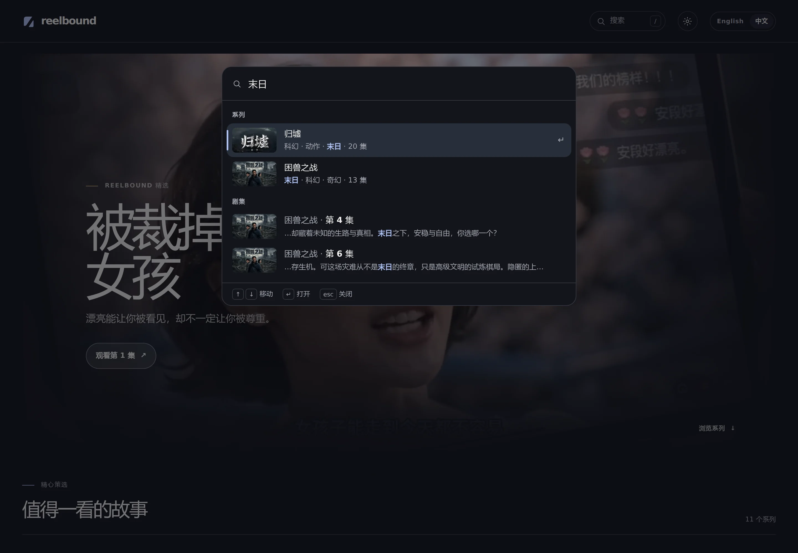
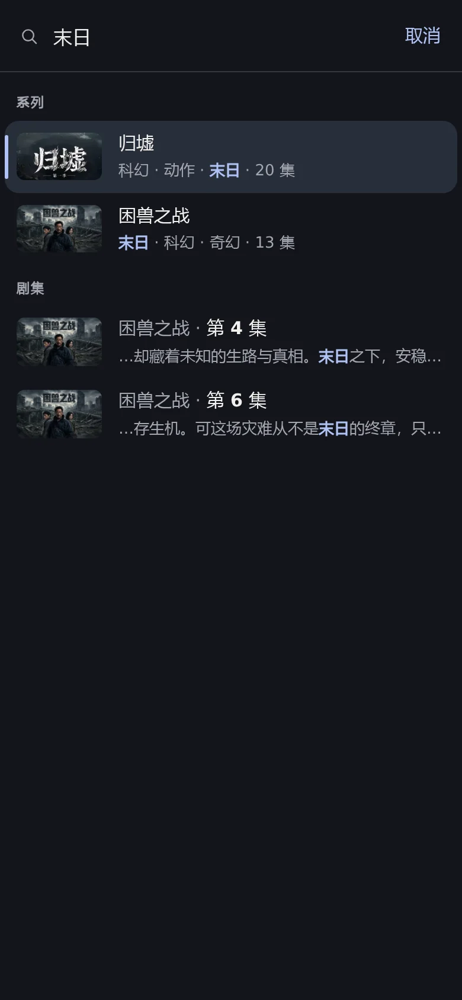
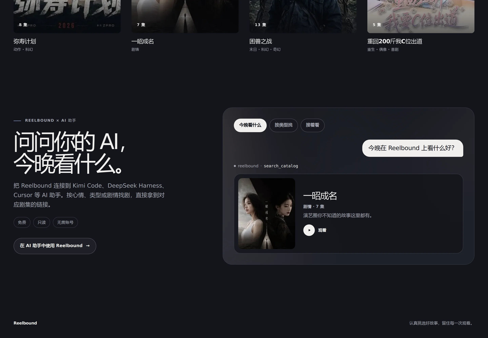
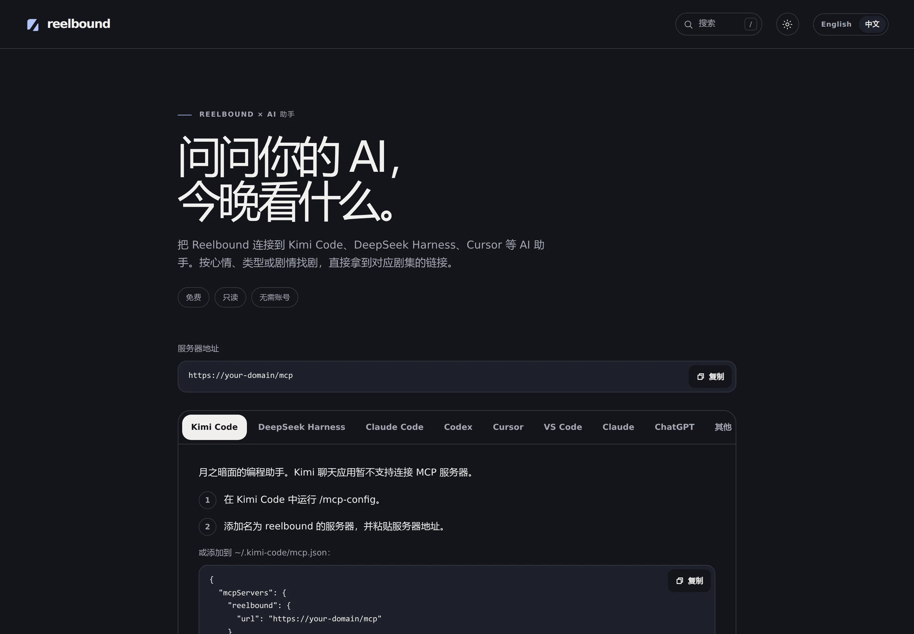
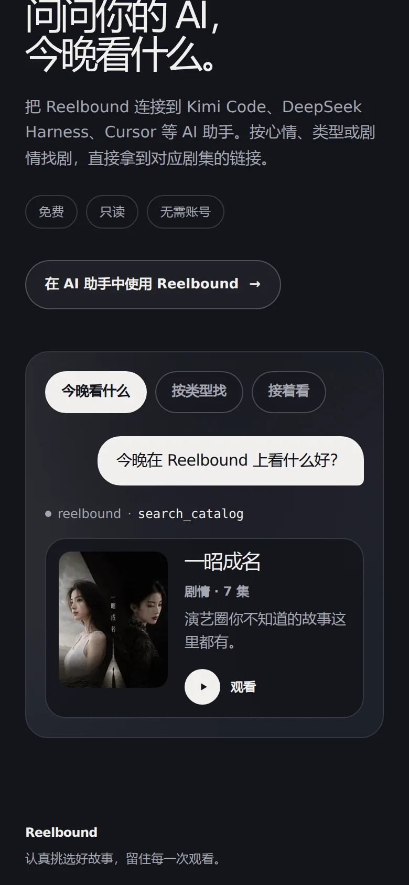
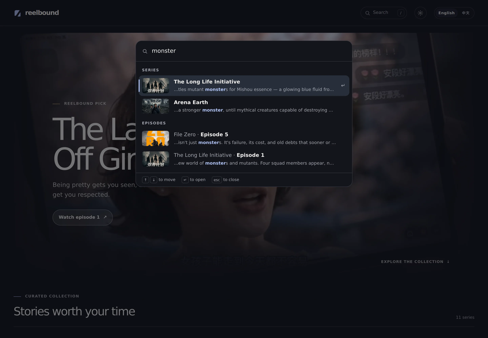

<h1 align="center">Reelbound</h1>

<p align="center">
  <strong>故事，从这一帧开始。精彩，未完待续。</strong><br>
  一个精心策展、富有电影感的 AI 生成短剧系列观看平台。
</p>

<p align="center">
  <a href="README.md">English</a> · <a href="README.zh-CN.md">简体中文</a>
</p>

<p align="center">
  <a href="https://github.com/yeoyujie/reelbound/actions/workflows/ci.yml"></a>
  <a href="LICENSE"></a>
  <a href="https://nextjs.org/"></a>
  <a href="https://react.dev/"></a>
  <a href="https://www.typescriptlang.org/"></a>
  <a href="https://pnpm.io/"></a>
</p>

<p align="center">
  
</p>

Reelbound 把 Netflix 式的“系列优先”体验带到短视频中。这里没有无尽的信息流：
**发现一个系列，从第一集开始，按顺序一直看下去**，视频通过抖音官方播放器播放。

```text
发现系列  →  打开剧集  →  观看  →  继续下一集
```

> 这是一个个人非商业项目。目前不提供账号、付费、广告或用户追踪功能。

## 界面一览

### 发现

精心挑选的系列目录，而不是零散的视频。卡片保持简洁，只展示海报、集数、标题和
类型；鼠标悬停或键盘聚焦时，卡片会在列表上方展开，显示简介和播放入口，其余海报
随之变暗。点击任意卡片即可从第一集开始观看。

<p align="center">
  
</p>

### 观看

播放器是页面的主角，旁边是完整的分集列表，当前集数一目了然。醒目的
**上一集 / 下一集**按钮会直接显示目标集数和标题，接下来看什么始终清清楚楚。
标题旁的**分享**按钮可以复制本集链接，或直接发送到 WhatsApp 和 Telegram。

<p align="center">
  
</p>

### 搜索

在任意页面按 `/` 或 `⌘K`，或点击**搜索**按钮，即可查找系列或直接跳到某一集。
无论页面是哪种语言，搜索都会同时匹配中英文的标题、类型和简介；它能识别
`nova 12`、`第12集` 这样的集数写法，并高亮显示每条结果的匹配原因。在手机上，
搜索以全屏面板打开。搜索索引很小，而且只在你准备搜索时才下载，不会拖慢首屏加载。

<table>
  <tr>
    <td align="center" width="72%"></td>
    <td align="center" width="28%"></td>
  </tr>
</table>

### 在 AI 助手中找剧

首页片单下方有一段简短演示，展示 Reelbound 在 AI 助手里的样子：选一个问题，
它会逐字打出来，随后答案以片单里的真实剧集出现，并附上可直接观看的链接。
**连接**页面提供服务器地址和各个助手的设置步骤，命令可一键复制，Cursor 和
VS Code 还支持一键安装。详见[在 AI 助手中使用](#在-ai-助手中使用)。

<p align="center">
  
</p>

<table>
  <tr>
    <td align="center" width="72%"></td>
    <td align="center" width="28%"></td>
  </tr>
</table>

### 为手机而设计

移动端经过专门设计，而不是把桌面版缩小：系列目录变为双列海报网格；观看页面中
播放器在最前，接着是剧集信息、通栏的**下一集**按钮和数字分集网格。

<table>
  <tr>
    <td align="center" width="33%"></td>
    <td align="center" width="33%"></td>
    <td align="center" width="33%"></td>
  </tr>
  <tr>
    <td align="center"><sub>精选系列</sub></td>
    <td align="center"><sub>双列海报网格</sub></td>
    <td align="center"><sub>先看视频，再选下一集</sub></td>
  </tr>
</table>

### 简体中文与 English

所有页面都提供简体中文和英文版本。系列标题、简介和集数标签都会针对不同观众
分别本地化，而不只是翻译界面文字。

<table>
  <tr>
    <th width="50%">简体中文</th>
    <th width="50%">English</th>
  </tr>
  <tr>
    <td></td>
    <td></td>
  </tr>
  <tr>
    <td align="center"></td>
    <td align="center"></td>
  </tr>
</table>

<details>
<summary>更多英文界面截图</summary>
<br>

| 首页 | 系列目录 | 搜索 | 移动端 |
| --- | --- | --- | --- |
|  |  |  |  |

</details>

<sub>所有截图均为默认的深色模式；只需点击一次即可切换到浅色主题。</sub>

## 功能特点

- 以**系列**为单位的精选目录；未配置缩略图时使用专门设计的备用封面
- 目录卡片在鼠标悬停或键盘聚焦时展开显示详情，并支持减少动态效果
- 支持多季、番外、分段剧集和合集，并自动编号
- 支持分享、精确到集数的观看链接，例如 `/zh-CN/series/gui-xu/episode/2`
- 支持键盘操作的搜索（`/` 或 `⌘K`），同时检索中英文的系列和剧集，可用
  `nova 12` 这样的写法直达某一集，并高亮匹配内容
- 每一集都有分享按钮，可复制链接或发送到 WhatsApp 和 Telegram
- 每一集和首页都有链接预览卡片，以页面语言显示系列海报、标题和集数。适用于
  Telegram、WhatsApp、Discord、Slack、iMessage、X、Facebook 和 LinkedIn。
  微信、抖音和小红书不读取标准的链接预览标签，在这些平台分享时不会显示卡片
- 使用抖音官方 iframe 播放器，并为竖屏视频响应式调整尺寸
- 上一集 / 下一集按钮直接显示目标剧集
- 分集列表始终清晰标识当前播放集数
- 支持简体中文和英文，以及深色和浅色主题
- 提供 MCP 服务器，Claude、ChatGPT、Cursor、Kimi Code 和 DeepSeek Harness 等
  AI 助手可以检索片单，并把观众直接带到对应剧集；`/connect` 页面提供各助手的
  接入步骤
- 使用静态 TypeScript 内容，无需数据库或用户账号系统；唯一的服务端接口是公开、
  只读的 MCP 服务器
- GitHub Actions 自动执行代码检查、生产构建、依赖审计和密钥扫描

## 在 AI 助手中使用

Reelbound 在 `/mcp` 提供公开、只读的 [Model Context Protocol](https://modelcontextprotocol.io/)
服务器。把它连接到 AI 助手后，可以直接问“给我找一部短一点的复仇剧”或“《NOVA》
第 3 集之后发生了什么？”。助手会根据片单回答，并附上对应剧集的链接，播放仍在
本站完成。

无需账号或登录。网站的**连接**页面（`/zh-CN/connect`，入口在首页片单下方）提供
Kimi Code、DeepSeek Harness、Claude、ChatGPT、Claude Code、Codex、Cursor 和
VS Code 的接入步骤，命令和配置都可一键复制。例如在 Claude Code 中：

```bash
claude mcp add --transport http reelbound https://<你的域名>/mcp
```

| 工具 | 作用 |
| --- | --- |
| `list_series` | 列出所有系列的简介、标签和集数，方便助手按心情或类型推荐 |
| `search_catalog` | 中英文检索系列和剧集，支持 `nova 12`、`第3集` 这样的写法 |
| `get_series` | 获取某个系列，以及按观看顺序排列的完整剧集列表 |
| `get_episode` | 获取某一集的详情，以及上一集和下一集 |

所有结果都是中英双语的结构化数据，并附带观看页链接。服务器基于官方
[MCP TypeScript SDK](https://github.com/modelcontextprotocol/typescript-sdk)，
采用无状态的 Streamable HTTP，同时支持 2025 和 2026 版 MCP 协议。为了在连接
前就能被发现，它还在 `/mcp/server-card` 提供
[MCP Server Card](https://modelcontextprotocol.io/seps/2127-mcp-server-cards)，
并在 `/.well-known/ai-catalog.json` 提供 AI Catalog。

Kimi 和 DeepSeek 的聊天应用暂不支持添加 MCP 服务器，因此国内用户可以通过
Kimi Code 或 DeepSeek Harness 接入。

## 技术栈

- [Next.js](https://nextjs.org/) 16 App Router
- [React](https://react.dev/) 19
- TypeScript
- Tailwind CSS 4，以及项目现有的全局 CSS
- pnpm
- 使用 Vercel 部署
- 使用 [MCP TypeScript SDK](https://github.com/modelcontextprotocol/typescript-sdk)
  v2 和 [Zod](https://zod.dev/) 构建 MCP 服务器
- 使用[抖音官方嵌入式播放器](https://open.douyin.com/)播放视频，并通过
  [抖音开放平台 API](https://developer.open-douyin.com/docs/resource/zh-CN/developer/introduction/overview)
  获取元数据和播放器尺寸

项目刻意不引入数据库或 CMS。这样可以让代码更容易理解，也让精选目录能够
通过版本控制稳定、可复现地维护。

## 当前范围

Reelbound 目前是一个精选观看平台，而不是社交网络。当前没有用户账号、社交
登录、个人主页、评论、点赞、关注、个性化推荐或“稍后观看”列表。视频目录
有意采用静态 TypeScript 内容进行精选和维护。

## 未来路线图

可能的后续方向（按优先级排序）：

- 在需要持久化用户功能时加入后端和数据库
- 支持可选的社交账号登录和用户账号
- 允许用户收藏剧集或视频以便稍后观看
- 保存观看进度，并提供“继续观看”历史
- 在具备完善审核机制后，引入评论等社区功能
- 使用轻量级编辑流程改进内容目录管理
- 随着目录增长，加入更丰富的元数据和自然语言搜索
- 探索微信链接预览，这需要微信官方分享 SDK 和已备案的域名

以上内容是探索中的想法，并不代表已实现的功能或确定承诺。任何账号或社区
功能上线前，都需要明确的隐私、审核、安全和数据保留政策。

## 本地运行

请使用 Node.js 24 和 pnpm 12.10.1。pnpm 版本已固定在
[`package.json`](package.json) 中。

```bash
pnpm install --frozen-lockfile
pnpm dev
```

然后打开 [http://localhost:3000](http://localhost:3000)。

如需以接近生产环境的方式运行：

```bash
pnpm build
pnpm start
```

## 内容目录

规范的数据模型位于
[`data/series/types.ts`](data/series/types.ts)。每个剧集都有独立的内容文件，
存放在 [`data/series/`](data/series/) 中；[`data/series.ts`](data/series.ts)
是控制展示顺序的目录清单。

### 添加或更新剧集

添加剧集时，在 `data/series/` 中创建一个类型安全的文件，然后在
`data/series.ts` 中添加对应的导入和条目。移动 `data/series.ts` 中的条目即可
调整首页顺序，第一项会最先显示。请保持每个剧集中的分集按集数排列，因为它们
也会控制上一集和下一集的导航。

### 本地化标题和简介

由于 Reelbound 面向英文观众呈现中文抖音系列，原始中文标题是内容的规范来源。
`title.en` 是可独立调整的英文本地化标题，不应决定剧集的技术身份。对于新的
中文剧集，请使用稳定的汉语拼音作为 slug 和内容文件名，例如 `归墟` 使用
`gui-xu`；像 `NOVA` 这样的品牌名则保留原本的拉丁字母写法。

### 内容字段

每个系列包含：

- `slug`：稳定的 URL 路径片段
- `title` 和 `description`，各自包含 `en` 和 `zh` 文本
- 可选的 `tags`、`thumbnail` 和季标题
- 按顺序排列的 `episodes` 数组

每一集只需要提供公开的抖音 `videoId`。集数和 URL 片段会根据每一季中的列表
顺序自动生成，因此 `title`、`label`、`season`、`kind`（`special` 或
`compilation`）等字段都是可选的。已知视频尺寸时，可以填写可选的
`videoWidth` 和 `videoHeight`；如果没有填写，应用会使用竖屏播放器默认值，并
可能通过抖音 iframe API 查询尺寸。`previewUrl` 为未来功能预留，目前不会被使用。

### 剧集路由和页面标题

剧集页面会根据目录在构建时生成，路由格式为：

```text
/[lang]/series/[slug]/episode/[episode]
```

`lang` 为 `en` 或 `zh-CN`。集数片段形如 `4`、`9-part-1`、`s2-e1` 或
`special-1`。

剧集页面的浏览器标题在两种语言中都采用“系列名称优先”的结构，同时保留各自
自然的标点和空格规范：

```text
The Laid-Off Girl — Episode 4 | Reelbound
被裁掉的女孩 · 第4集｜Reelbound
```

英文使用长破折号分隔系列名称和剧集信息；中文使用间隔号作为紧凑的内容分隔符，
并在平台名称前使用全角竖线。

### 播放器集成

播放器 URL 的构造和 iframe 行为集中在
[`components/video-player.tsx`](components/video-player.tsx) 中，避免将平台
相关细节散落在其他 UI 组件里。

## 项目结构

```text
app/[lang]/                  多语言 App Router 页面和布局
app/globals.css              全局样式和设计变量
components/                  Header、卡片、剧集列表、导航和播放器
lib/                         集数编号、本地化、搜索、分享卡片和 MCP
app/mcp/                     MCP 接口及其 Server Card
app/[lang]/connect/          AI 助手接入指南
assets/fonts/                构建分享卡片时使用的中文字体
data/series.ts               有序的视频目录清单
data/series/                 每个系列一个 TypeScript 内容文件
docs/screenshots/            README 截图
.github/workflows/ci.yml     代码检查、构建、安全和依赖检查
```

## 检查与部署

你可以在本地运行主要检查：

```bash
pnpm lint
pnpm test
pnpm build
```

GitHub Actions 会针对以 `main` 为目标分支的 Pull Request，以及推送到 `main`
的提交运行代码检查和生产构建。同时还会执行生产依赖审计、Dependabot/依赖
审查和 Gitleaks Git 历史密钥扫描。定期安全工作流每周运行一次。

Vercel 通过 Git 集成处理部署：Pull Request 和功能分支会获得 Preview 部署，
`main` 分支会部署到 Production。GitHub Actions 负责验证代码，不负责部署。

绝对地址（canonical 和 `hreflang` 链接、链接预览图片，以及 MCP 返回的观看链接）
在设置了 `SITE_URL` 时以它为准。请只在 Production 环境中把它设为自定义域名，
这样 Preview 部署会链接到自己。未设置时，依次回退到 Vercel 的生产或分支地址，
最后是 `http://localhost:3000`。

## 内容、版权与许可

Reelbound 的原创源代码采用
[MIT License](LICENSE) 授权。你可以使用、修改、分发和商业化这些源代码，但
必须按照许可证要求保留版权声明和许可证文本。

目录中的视频 ID 和嵌入视频来自抖音，相关内容仍受视频创作者、发布者及平台条款
约束。Reelbound 不主张拥有这些视频的版权，不下载或重新托管视频文件，而是使用
抖音官方嵌入播放器。MIT License 不会授予复制、分发、商业化或以其他方式使用
这些第三方内容的权利。关于署名请求和第三方内容边界，请参阅
[`NOTICE`](NOTICE)。

`assets/fonts/` 中附带的 Noto Sans SC 字体属于第三方软件，采用
[SIL Open Font License 1.1](assets/fonts/NotoSansSC-LICENSE.txt) 授权，
不适用 MIT License。

如果你是目录中内容的版权所有者或代理人，并希望移除相关内容，请提交 Issue，
并提供足以定位系列或剧集的信息。

## 参与贡献

请让改动围绕精选观看体验展开。添加系列时，请使用稳定的 slug，保持集数顺序，
确认视频 ID 可以通过官方播放器公开播放，并在提交 Pull Request 前运行
`pnpm lint` 和 `pnpm build`。

## 许可证

Reelbound 原创源代码：[MIT License](LICENSE)。

第三方内容不在 MIT License 的授权范围内，详情请参阅 [`NOTICE`](NOTICE)。
